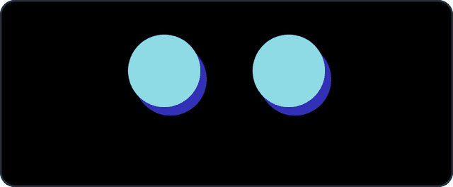

<p align="center">
  
</p>

<h1 align="center">폴라 · Pola</h1>

<p align="center">
  화면 전체가 눈이고, 목소리로만 대화하는 안드로이드 음성 친구예요.<br>
  “<b>폴라야</b>” 하고 부르면 대답해요.
</p>

---

## 이런 걸 해요

| | |
|---|---|
| 🗣️ **음성 대화** | 항상 듣고 있다가 “폴라야”라고 부르면 대답해요. 대답한 뒤 30초 동안은 호출어 없이도 이어서 말할 수 있어요. |
| 🧠 **자동 기억** | 이름, 가족, 취향, 일정을 말하면 알아서 기억해요. |
| 👀 **물체 인식** | “이거 뭐야?”, “이 글자 읽어줘” 하면 카메라로 보고 대답해요. |
| 📸 **사진 + 손동작** | 사진을 찍으면 작은 미리보기가 떠요. 손을 **주먹 쥐었다 펴면** 크게 보이고, **엄지척**은 저장, **양손 검지로 X**는 삭제예요. |
| 🎭 **눈 표정 50가지** | 기분에 맞는 표정을 알아서 골라요. |
| 🌀 **움직임 반응** | 흔들면 어지러워하고, 뒤집으면 놀라고, 떨어뜨리면 비명을 질러요. |
| 🙂 **사람 같은 말투** | 맞장구, 공감, 되묻기, 가끔 “음…” 하며 생각하는 소리도 내요. |
| ⏰ **생활 기능** | 타이머, 알람, 할 일, 시계·배터리 화면, 소리 조절, 잠자기. |

## 처음 시작하기

1. APK를 설치하고 실행하면 설정 화면이 나와요.
2. 쓸 AI 서비스를 고르고 API 키를 넣어요.
   - **Google Gemini** — [AI Studio](https://aistudio.google.com/apikey)에서 키를 만들어요. (`AIza...`) 기본 모델 `gemini-2.5-flash`
   - **Groq** — [Groq 콘솔](https://console.groq.com/keys)에서 키를 만들어요. (`gsk_...`) 기본 대화 모델 `llama-3.3-70b-versatile`, 사진 보는 모델 `qwen/qwen3.8-27b`
3. 저장하면 폴라가 인사해요. “폴라야” 하고 불러 보세요!

> 서비스마다 키와 모델 이름이 따로 저장돼요. 모델 이름은 서비스가 자주 바꾸니, 오류가 나면 최신 이름으로 바꿔 넣으세요. 칸을 비우면 기본값을 써요.

## 말로 해 보세요

```
폴라야, 내 이름은 민수야          → 기억해요
이거 뭐야?                        → 카메라로 보고 알려줘요
사진 찍어줘 / 셀카 찍어줘          → 3, 2, 1 하고 찍어요
타이머 3분 / 내일 7시에 알람       → 맞춰 줘요
시계 보여줘 / 배터리 보여줘        → 화면을 바꿔요
천천히 말해줘 / 목소리 높게        → 말투를 바꿔요
설정 보여줘                       → 설정 화면이 열려요
잘자                              → 잠들어요
```

## 사진과 손동작

```
사진 찍기 ─▶ 작은 미리보기 ─▶ ✊ 쥐었다 ✋ 펴기 ─▶ 거의 전체 화면
                                                   ┌────────────────────┐
                                                   │ 🗑️     사진     👍 │
                                                   └────────────────────┘
                                                  검지로 X = 삭제   엄지척 = 저장
```

- 손동작은 앞 카메라로 인식해요. 처음 한 번은 손 인식 모델을 받느라 몇 초 걸려요.
- 손 인식이 잘 안 되면 작은 사진을 눌러서 크게 보고, 🗑️ 또는 👍를 눌러도 돼요.
- 아무것도 안 하면 30~40초 뒤 자동 저장돼서 사진이 사라지지 않아요.
- 저장된 사진은 갤러리의 **Pola** 폴더에 있어요.

## 몸으로 반응해요

| 이렇게 하면 | 폴라는 |
|---|---|
| 흔들기 | “어어어, 어지러워요!” — 눈이 빙글빙글 돌아요 |
| 3초 넘게 흔들기 | “우웩… 속이 울렁거려요” |
| 7초 넘게 흔들기 | “아 진짜, 그만하라고요!” |
| 뒤집기 · 빙글빙글 돌리기 | “세상이 뒤집혔어요!” · “어지러워요!” |
| 떨어뜨리기 | “으아아악!” → “휴… 놀랐잖아요.” |
| 톡 부딪히기 | “아야!” |
| 화면을 바닥으로 엎기 | “앗, 깜깜해요!” (오래 두면 잠들어요) |
| 기울이기 | 눈동자가 기울어진 쪽으로 쏠려요 |
| 자는 중에 흔들기 | “으음… 왜 깨워요, 졸린데…” |

설정에서 **움직임에 반응하기**를 끌 수 있어요.

## 눈을 만지면

눈을 한 번 누르면 옆에 `?`가 하나 떠요. 계속 누르면 `?`가 3개까지 늘고, 그다음에는 짜증 난 표정(눈꺼풀이 내려오고 떨리며 💢)을 지어요. 소리는 나지 않아요.

한동안 말을 걸지 않으면 3분쯤부터 졸기 시작하고, 5분이 되면 잠들어요. 눈을 누르거나 “폴라야”라고 부르면 깨요.

## 설정

“**폴라야, 설정 보여줘**”라고 말하거나 화면을 1.5초 길게 누르면 열려요.

- AI 서비스 · API 키 · 모델
- 🗣️ 목소리 고르기 · 말하는 속도 · 높낮이 · 들어보기
- 소리로 대답하기 · “폴라야”로 불러야 대답하기 · 움직임에 반응하기
- 내 이름 · 사진 찍을 때 기본 카메라
- 기억 모두 지우기

## 눈 표정 50가지

- **기본**: 기쁨, 평범, 놀람, 졸림, 슬픔, 사랑, 화남, 시크, 윙크
- **좋은 기분**: 환호, 크게웃음, 신남, 으쓱, 부끄러움, 뿌듯, 반짝감탄, 하트눈, 장난, 편안, 짓궂음
- **나쁜 기분**: 눈물, 엉엉, 격분, 심술, 삐침, 실망, 걱정, 무서움, 긴장, 충격
- **생각·상태**: 생각중, 궁금, 혼란, 의심, 반신반의, 지루, 피곤, 어지러움, 아이디어, 집중
- **특별한 표정**: 기절, 어이없음, 멍함, 추움, 맛있음, 메스꺼움, 감동, 욕심, 애원, 로봇

표정 이름과 모양은 `app/src/main/assets/index.html`의 `MOODS` 목록과 `data-mood` 스타일에서 바꿀 수 있어요.

## APK 받기

이 저장소에 파일을 올리면 GitHub Actions가 자동으로 APK를 만들어요.

1. 위쪽 **Actions** 탭에서 `Build APK`가 초록 체크(✓)로 끝났는지 확인해요.
2. 오른쪽 **Releases**에서 가장 최근 `폴라 build N`의 `pola.apk`를 내려받아요.
3. 설치할 때 “출처를 알 수 없는 앱 설치 허용”이 필요해요.

다시 빌드하려면 **Actions → Build APK → Run workflow**를 눌러요.

## 개인정보와 보안

- API 키는 폰 안에만 저장돼요. 이 저장소에는 키가 들어 있지 않아요. 코드나 이슈에 키를 올리지 마세요.
- 대화 내용과 카메라로 찍은 사진은 답변을 만들기 위해 선택한 서비스(Google Gemini 또는 Groq)로 전송돼요.
- 얼굴 정보는 저장하지 않아요. “이 사람은 ○○야 기억해”라고 하면 옷차림과 주변만 메모해요.
- 손동작 인식은 폰 안에서 처리돼요. (인식 모델 파일만 인터넷에서 받아요.)
- 음성 인식은 기기의 Google 음성 서비스를 써요.
- 무료 키는 사용량 제한이 있어서, 너무 자주 말하면 “잠깐 숨 고를게요”라고 대답할 수 있어요.

## 알아둘 점

- 앱이 켜져 있고 화면이 켜진 동안만 듣고, 알람도 그때만 울려요.
- 빌드되는 APK는 테스트용 서명(debug)이라 설치는 되지만 Play 스토어에는 올릴 수 없어요.
- `app/src/main/assets/index.html`을 크롬에서 열어도 대부분 테스트할 수 있어요.

## 구성

| 파일 | 하는 일 |
|---|---|
| `app/src/main/assets/index.html` | 화면과 대화 로직, 손동작·움직임 반응 전부 |
| `app/src/main/java/com/pola/assistant/MainActivity.kt` | 음성 인식, 음성 출력(목소리 선택), 사진 저장, 권한 |
| `.github/workflows/build.yml` | 자동 빌드 |
| `pola-eyes.gif` | 이 문서 맨 위의 눈 애니메이션 |
